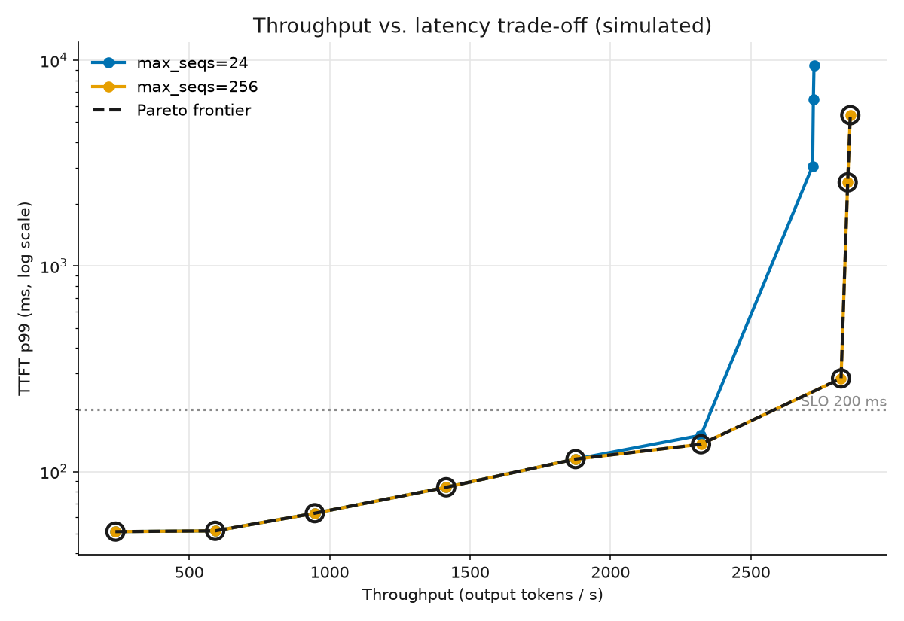

# vLLM latency simulator (no GPU)

Predict how a vLLM server will behave (time-to-first-token, time-per-token,
throughput, queueing) without running a GPU. It's a small pure-Python model of
the vLLM v1 engine. It replays the real scheduler and KV-cache logic, and
replaces only the GPU forward pass with a measured latency formula.

Useful for capacity planning and cost/latency estimates. For example: at N
requests/sec, what TTFT will users see, and how much throughput fits under my
SLO?

## How it works

Three moving parts, looped once per engine step:

1. **Scheduler** picks which requests run this step (token budget, concurrency
   cap, chunked prefill), exactly like vLLM's two-pass scheduler.
2. **KV cache** counts memory blocks with vLLM's real formulas. When they run
   out, requests get preempted. Prefix caching is hash-based, so cache hits
   emerge from the workload instead of being set by hand.
3. **Cost model** predicts each step's duration from the batch shape:
   `t = a + b*C + c*B + d*S`. You fit the constants once to real GPU
   measurements. Everything else is exact bookkeeping.

Latencies are just the clock summed over steps.

## Install & run

```bash
pip install -r requirements.txt
python demo.py        # rate sweep plus a prefix-caching example
```

It's fast. Pure Python, about 6,000 simulated requests/sec on one CPU core
(`python bench.py`), so sweeps and what-ifs are instant.

## Example

```python
from kv import ModelConfig, num_blocks_from_memory
from cost_model import CostModel
from workload import make_workload
from simulator import Simulator, SchedulerConfig

cfg  = ModelConfig(num_layers=32, num_kv_heads=8, head_size=128, max_model_len=8192)
cost = CostModel(a=5e-4, b=3e-5, c=1e-4, d=4e-8)          # or CostModel.load(...)
blocks = num_blocks_from_memory(cfg, available_kv_bytes=int(50e9))

reqs = make_workload(n=300, rate=15, prompt_len=(2048, 128), output_len=(128, 64),
                     num_prefix_groups=8, shared_prefix_len=1536)  # shared system prompt

m = Simulator(cfg, SchedulerConfig(), cost, blocks).run(reqs)
print(f"{m['throughput_tok_s']:.0f} tok/s  "
      f"TTFT p99 {m['ttft_s']['p99']*1e3:.0f}ms  "
      f"prefix hit {m['prefix_hit_rate']*100:.0f}%")
```

## Getting real numbers

The formula constants are hardware-specific, so fit them to your GPU once:

```bash
python calibrate.py grid > shapes.csv       # batch shapes to measure
# measure each shape with `vllm bench forward` on a GPU, fill in t_seconds
python calibrate.py fit shapes.csv cost_model.json
```

`fit` tries two models and keeps the better one:

- **linear**, `t = a + b*C + c*B + d*S`, simple and interpretable.
- **roofline**, `t = max(compute, memory)`, more accurate near the
  prefill/decode crossover (about 4% error vs about 24% for linear on
  regime-split data).

Then sanity-check against a real `vllm bench serve` run at a couple of rates.

Tip: you can skip the memory math and just read `# GPU blocks: N` from vLLM's
startup log, then pass it as `num_gpu_blocks`.

## Pareto sweep

`python pareto.py` sweeps request rate across configs and plots the
throughput-vs-latency trade-off with the best-choice frontier:



## Tuning knobs for realism

`SchedulerConfig` has two options for matching a real deployment:

- `request_overhead_s`: fixed per-request latency outside the batched forward
  (tokenization, request handling). Added to TTFT and E2E. Calibrate from the
  low-load TTFT gap.
- `admission_headroom_blocks_per_running`: keep this many free KV blocks per
  running request before admitting a new one, so the engine holds requests in
  the queue instead of over-admitting into a preemption spiral under overload.

`metrics` also reports `preemptions` and `max_running` for diagnosing saturation.

## What it doesn't model

Recompute-only preemption (no CPU swap), a single engine (no pipeline or data
parallel overlap), and no speculative decoding. Arrivals are synthetic unless you
feed a trace. These are the labeled extension points.

## Prior art

[Vidur](https://arxiv.org/abs/2405.05465) (calibrated LLM-serving simulator) and
the Sarathi chunked-prefill paper (per-step cost model).
