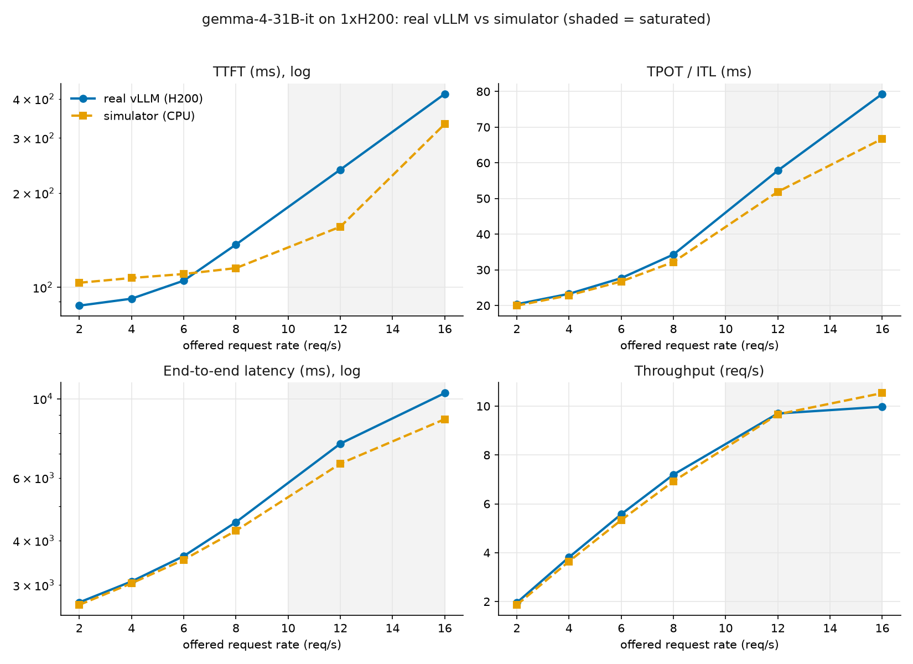

# Validation against a real vLLM deployment

The simulator was checked against a real vLLM server (gemma-4-31B-it on one
NVIDIA H200). This directory has everything to reproduce the comparison, with no
GPU or cluster needed.

```bash
python examples/compare.py --plot
```

## Method

1. **Calibrate.** Timed 22 exact batch shapes on the real GPU with
   `vllm bench forward` (decode at various batch/context, prefill 512..8192, and
   mixed), then fit the roofline cost model. Result: `gemma4_h200_roofline.json`,
   fit to **3.9% MAPE** (the linear model gets 16% on the same data, because it
   can't fit flat-decode and super-linear-prefill with one line).
2. **Measure.** Ran `vllm bench serve` at request rates spanning before and after
   saturation (512-in / 128-out, 200 prompts each). Result: `real_serve.json`.
3. **Simulate.** Ran the simulator at the same rates, with KV blocks set to
   vLLM's reported capacity (75,121 tokens, 9.17x max concurrency).

## Result



- **Before saturation: all five metrics (throughput, TTFT, TPOT, ITL, E2E) match
  within ~6%.**
- **At the ~10 req/s capacity**, the simulator reproduces the throughput plateau
  and the latency knee.
- **Deep in saturation**, throughput stays accurate (±6%) while latency
  under-predicts by ~15-35%: the simplified scheduler under-models prefill/decode
  contention under heavy overload. This is the known fidelity limit.

## Physical sanity check

The fitted decode floor is **17.6 ms**. The model is 60 GB in bf16 and the H200
has ~3.35 TB/s HBM bandwidth, so 60 GB / 3.35 TB/s ≈ 17.9 ms. The simulator
recovered the GPU's memory bandwidth from timing alone, confirming decode is
weight-bandwidth bound.

## Files

| file | contents |
|------|----------|
| `gemma4_h200_roofline.json` | calibrated roofline cost model (coefficients) |
| `real_serve.json` | real `vllm bench serve` metrics per request rate |
| `compare.py` | runs the simulator and prints/plots the comparison |
| `latency_compare.png` | the rendered comparison |
